# C4 level 3 — representative components

This component view describes recurring repository roles without claiming every Level 1 example contains every component.

```mermaid
flowchart TB
  subgraph Focused[Level 1 focused example]
    Host1[Protocol/UI host]
    Concern[Mechanism integration]
    Host1 --> Concern
  end
  subgraph InfraFocused[Level 1 infrastructure example]
    InfraHost[Weather host]
    Adapter[shared/Infrastructure adapter]
    Provider[Redis / RabbitMQ / Key Vault / Serilog sink]
    InfraHost --> Adapter --> Provider
  end
  subgraph Layered[Level 2 layered example]
    Delivery[REST / gRPC / GraphQL / SOAP delivery]
    Mapping[DTO and mapping layer]
    SharedData[Shared Todo service and EF Core SQLite]
    Delivery --> Mapping --> SharedData
  end
  subgraph Reference[Level 3 architecture reference]
    Grpc[gRPC host / composition root]
    Application[Application services or CQRS handlers]
    Domain[Domain entities and rules]
    Infrastructure[EF Core repository implementations]
    Tests[Unit and integration tests]
    Grpc --> Application
    Grpc --> Infrastructure
    Infrastructure --> Application
    Application --> Domain
    Infrastructure --> Domain
    Tests --> Application
    Tests --> Infrastructure
  end
```

Infrastructure hosts keep Weather behavior in the example project and delegate Redis, RabbitMQ, Key Vault, and Serilog wiring to the matching `Exp.Shared.*` adapter. The background-service example has no adapter. See the [shared infrastructure README](../../../../shared/Infrastructure/README.md).

Dependency direction—not the use or absence of dependency injection or MediatR—is the relevant architectural test in the Level 3 examples.
