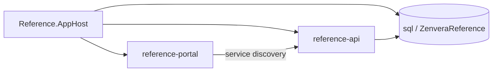

# .NET Aspire reference

## Objective

Show a self-contained .NET Aspire local orchestration topology: AppHost composition, ServiceDefaults, SQL Server, service discovery, health checks, OpenTelemetry, and a Blazor Server portal calling a REST API.

## Maturity level

**Level 2 — Layered Example.** Hosts stay small and focused on Aspire wiring rather than Clean Architecture layering. The lesson is repository-local orchestration, not domain design.

## What it demonstrates

- AppHost declaring SQL Server, a REST API host, and a Blazor Server portal
- Logical resource names (`sql`, `reference-db`, `reference-api`, `reference-portal`)
- `WaitFor` / health-driven startup instead of fixed sleeps
- ServiceDefaults for telemetry, health, discovery, and HTTP resilience
- Blazor calling the API through `https+http://reference-api` (service discovery)
- Repeatable database create + seed
- Closed-box orchestration tests that start AppHost

## What it intentionally omits

- Authentication and authorization
- Production Aspire publishing or container image publishing for AppHost
- Coupling to any other example under `src/ApiStyles`, `Authentication`, `Infrastructure`, etc.
- Full EF migrations (uses `EnsureCreated` for the teaching sample)
- Shared `Zenvera.Shared.Telemetry` integration (deferred to shared-package alignment)

## Architecture



This area is independently runnable. It does not start or reference other catalog examples.

## Project structure

```text
src/Reference/
  Zenvera.DotNetExamples.Reference.AppHost/
  Zenvera.DotNetExamples.Reference.ServiceDefaults/
  Zenvera.DotNetExamples.Reference.RestApiHost/
  Zenvera.DotNetExamples.Reference.BlazorServerHost/
tests/Reference/
  Zenvera.DotNetExamples.Reference.Tests/
```

## Configuration

| Resource | Classification | Notes |
|---|---|---|
| `sql` | Ephemeral (default Session lifetime) | Clean SQL container each AppHost run |
| `reference-db` | Database `ZenveraReference` | Connection injected into the API |
| `reference-api` | Product host | Owns `/notes`, `/health`, `/alive` |
| `reference-portal` | Browser-visible host | External HTTP endpoints |

To retain SQL data across local runs, chain `.WithLifetime(ContainerLifetime.Persistent)` on the SQL resource in AppHost and document the volume. Prefer the default session lifetime for tests.

Compose under `deploy/local/compose.yml` remains available for other examples. This Aspire sample does not replace it.

## How to run

Prerequisites: .NET SDK 10 and a container runtime (Docker Desktop or compatible).

```powershell
dotnet run --project src/Reference/Zenvera.DotNetExamples.Reference.AppHost
```

Open the Aspire dashboard URL printed in the console, then open the `reference-portal` endpoint. Use **Notes** to exercise API + SQL through service discovery.

Category solution:

```powershell
dotnet build solutions/zenvera.reference.slnx
```

## Test scenarios

```powershell
dotnet test tests/Reference/Zenvera.DotNetExamples.Reference.Tests
```

- Happy path: AppHost starts; `GET /notes` returns seeded notes.
- Portal path: `reference-portal` root returns HTTP 200.
- Failure case: stop the container runtime and confirm AppHost cannot start SQL / API healthily.

## Production considerations

AppHost and ServiceDefaults are not production deployable units. Deploy the named product hosts separately if you promote this pattern. Add real migrations, authn/authz, secret management, and non-development health endpoint policy before production use.

## Related examples

- Infrastructure SQL/Redis/RabbitMQ examples still use Compose for their own focused lessons.
- Clean Architecture gRPC samples teach layering, not Aspire orchestration.

## Related standards

- Zenvera `.NET Aspire Standards` (237)
- Zenvera ADR-008: Aspire for repository-local orchestration
- Repository ADR-001: reference-example monorepo
